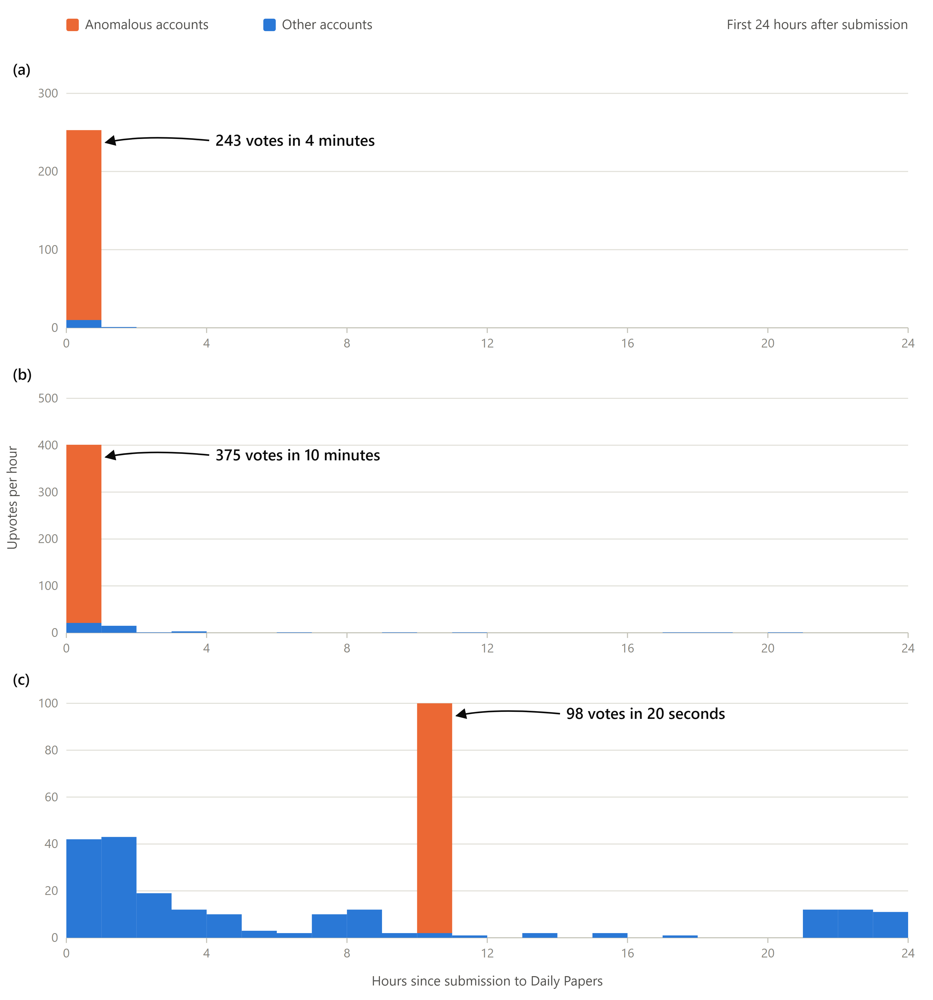
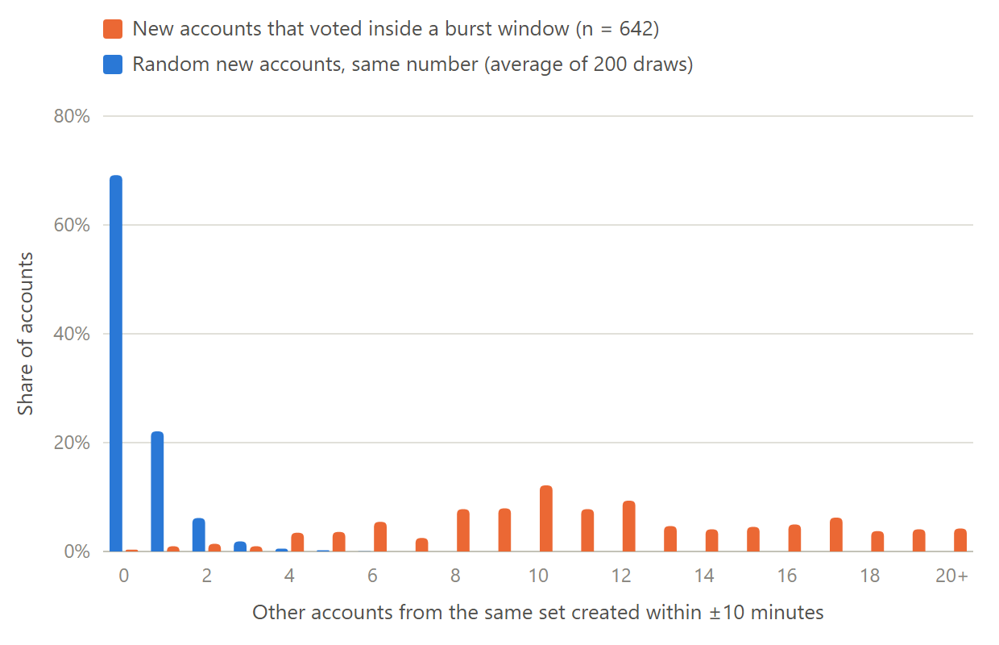

# Coordinated Upvoting on Hugging Face Daily Papers

## Highlight

We found ~740 accounts that show strong signs of scripted upvoting on [Hugging Face Daily Papers](https://huggingface.co/papers).
These accounts were potentially created by multiple groups.
We support this with three lines of evidence: burst voting, clustered account creation, and scripted fake datasets/models.

All data comes from public Hugging Face APIs, collected on Oct 28–29, 2026.
This repository contains the code, a snapshot of the raw API responses, and the outputs behind every number below.

## How We Flag Accounts

We scan the upvoters of every paper with 100+ upvotes in the 120 days before Oct 29.
Candidates are new accounts that were created in tight batches and upvote the same papers as each other.
A candidate is flagged if it takes part in a **mass burst** -- 50+ candidate votes on one paper within 10 minutes.
This gives 739 accounts (`in_mass_burst` in `data/account_tiers.csv`).

Since creation time is used to pick candidates, Evidence 2 below does not use the flags at all.

## Evidence

### 1. Burst Voting



On six papers, the flagged accounts cast 50–102 upvotes within a single minute.
On the same papers, all other voters combined never exceeded 12 upvotes in any minute (`data/burst_metrics.csv`).

| Paper | Burst votes | Burst duration | Busiest minute (flagged) | Busiest minute (everyone else) |
|---|---|---|---|---|
| 2610.36077 | 215 | 5.5 min | 102 | 2 |
| 2609.15818 | 98 | 20s | 98 | 5 |
| 2609.06986 | 256 | 4.2 min | 84 | 3 |
| 2610.35201 | 243 | 4.0 min | 67 | 1 |
| 2608.12564 | 375 | 10 min | 62 | 3 |
| 2609.02749 | 50 | 10s | 50 | 12 |

On Oct 19, 55 accounts, all created on Oct 16 between 12:41 and 18:35 UTC, each upvoted the same 11 papers at a rate of one paper every 1.8 seconds.
These papers had been submitted weeks to months earlier, so this might have been a test (`data/oct19_push.csv`).

### 2. Clustered Account Creation



Here we select accounts only by *when they voted*: every new account whose vote falls inside one of the six burst windows above, flagged or not (642 accounts, `data/burst_window_voters.csv`).
These accounts were created in tight batches.
A typical one has 11 others from the same set created within 10 minutes of it, and 93% have at least 5.
For the same number of random new accounts, the median is 0, and at most 1.9% have at least 5 over 200 draws (`data/creation_clustering.csv`).
We read the creation time from the account ID.

### 3. Fake Datasets and Models

On Sep 11, 283 accounts each created a dataset within 5.4 minutes, a median of 1.1s apart.
Ten minutes later, 281 accounts each created an empty model within 2.5 minutes, a median of 0.5s apart (`data/fingerprint_runs.csv`, `data/fingerprint_repos.csv`).
400 of the 739 flagged accounts took part in these two runs.

* All of these repos have generated names, e.g., `SableField/efficient-team-4a18b8` and `Drift-Wxue/aggressive-sail-c9067a`.
* The models contain only `.gitattributes`.
* The 30 datasets we sampled each contain just a `README.md` and a `data.csv`.

## Limitations

* We show coordinated voting, not who is behind it. Anyone can upvote any paper.
* Our numbers are lower bounds, since we only scan papers with 100+ upvotes.

## Reproduce

We have only tested this on Windows with Python 3.11. No third-party packages are needed.

```bash
python reproduce.py            # rerun everything offline from data/raw.tar.xz
python reproduce.py --figures  # also redraw the figures (needs Microsoft Edge or another Chromium-based browser)
```

`reproduce.py` extracts the API snapshot (`data/raw.tar.xz`, 12 MB) and runs every script in order without network access.
The outputs match the CSVs in `data/` exactly.
With `--online`, anything missing from the snapshot is fetched from the live API instead -- note that the live data has changed since our collection.

| File | Contents |
|---|---|
| `data/account_tiers.csv` | every candidate account, with `in_mass_burst` |
| `data/mass_bursts.csv`, `data/burst_metrics.csv` | all mass bursts and their timing |
| `data/oct19_push.csv` | accounts that voted on Oct 19 07:00–07:15 UTC |
| `data/burst_window_voters.csv`, `data/creation_clustering.csv` | accounts selected by vote time, and their creation clustering |
| `data/fingerprint_repos.csv`, `data/fingerprint_runs.csv` | generated-name repos and their creation runs |
